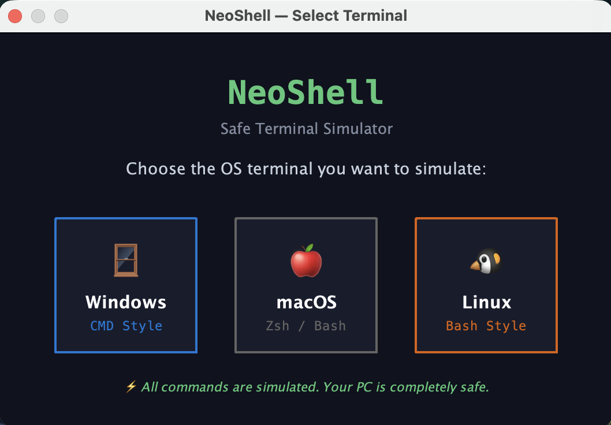
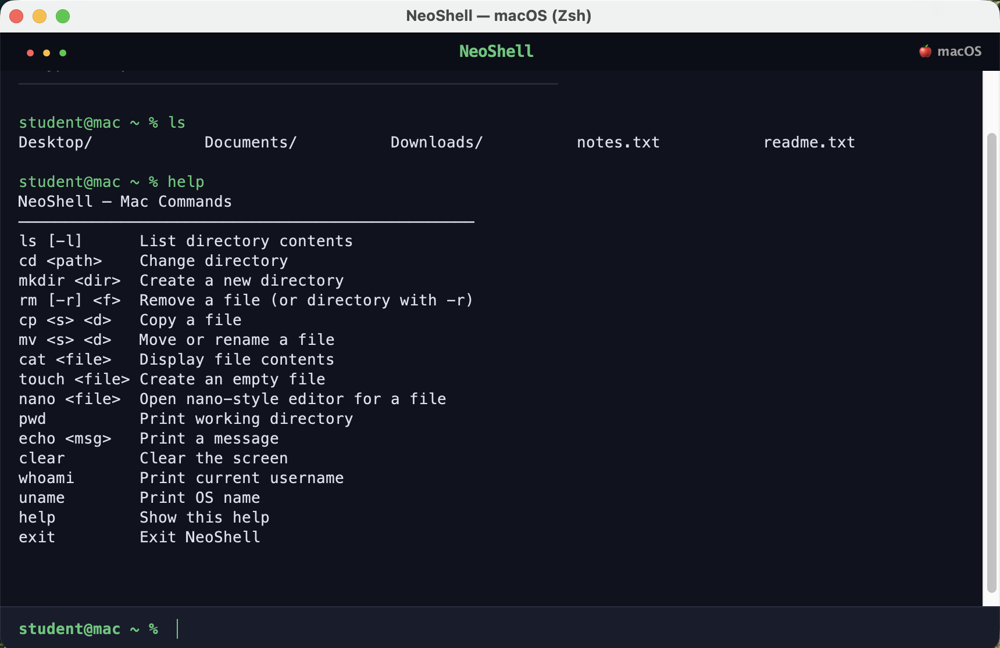
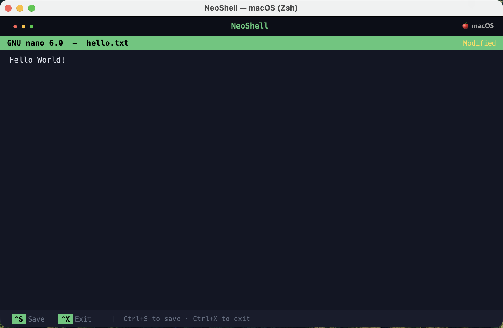

<div align="center">

# 💻 NeoShell

### Practice terminal commands without the fear of breaking your computer




</div>

**NeoShell** is a desktop terminal simulator built with **Java Swing**. Pick **Windows CMD**, **macOS Zsh** or **Linux Bash**, and you get a terminal that looks and behaves like the real one. The difference is that every command runs inside an **in-memory virtual file system**, so nothing ever touches your actual disk. ⚡

---

## 🤔 Why I built it

A lot of beginners avoid the terminal because they're scared of typing the wrong thing: deleting files, messing up permissions or breaking the system. Setting up a virtual machine just to learn `cd` and `mkdir` feels like overkill.

NeoShell is my answer to that. You can type `rm -r` on anything you want and the worst that happens is a fake folder disappears. Make mistakes, experiment, learn. 🧪

## ✨ Features

- 🖥️ **3 OS modes**: Windows CMD, macOS Zsh and Linux Bash, each with its own prompt and command set
- 🗂️ **Virtual file system**: real folders and files, all kept in memory
- ↪️ **Redirection**: `>` to write and `>>` to append output to a file
- 📝 **nano-style editor**: `nano notes.txt` opens a built-in editor (`Ctrl+S` to save, `Ctrl+X` to exit)
- ⏪ **Command history** with the ↑ and ↓ keys
- 🎨 **Colored output**: green prompts, white output, red errors
- 🌙 Clean dark terminal UI
- 🔌 Works completely **offline**: no accounts, no tracking

## 📸 Screenshots

| macOS mode + `help` | Built-in nano editor |
| :---: | :---: |
|  |  |

## ⌨️ Supported commands

<table>
<tr><th>🐧 Linux / 🍎 macOS</th><th>🪟 Windows CMD</th></tr>
<tr valign="top"><td>

| Command | What it does |
| --- | --- |
| `ls [-l]` | List directory contents |
| `cd <path>` | Change directory |
| `pwd` | Print working directory |
| `mkdir <dir>` | Create a directory |
| `touch <file>` | Create an empty file |
| `cat <file>` | Show file contents |
| `cp <src> <dest>` | Copy a file |
| `mv <src> <dest>` | Move or rename |
| `rm [-r] <path>` | Remove a file or folder |
| `echo <msg> [> file]` | Print or write to a file |
| `nano <file>` | Open the editor |
| `whoami` · `uname` | User and OS name |
| `clear` · `help` · `exit` | The usual |

</td><td>

| Command | What it does |
| --- | --- |
| `dir` | List directory contents |
| `cd <path>` | Change directory |
| `mkdir <dir>` | Create a directory |
| `type <file>` | Show file contents |
| `copy <src> <dest>` | Copy a file |
| `move <src> <dest>` | Move or rename |
| `del <file>` | Delete a file |
| `rmdir <dir>` | Remove a directory |
| `echo <msg> [> file]` | Print or write to a file |
| `nano <file>` | Open the editor |
| `whoami` · `ver` | User and version |
| `cls` · `help` · `exit` | The usual |

</td></tr>
</table>

## 🚀 Getting started

**Requirements:** JDK 25 and Maven.

```bash
git clone https://github.com/abdullahaljubayer-101/neoshell.git
cd neoshell
mvn clean compile
java -cp target/classes com.neoshell.Main
```

Or open the project in **IntelliJ IDEA** and run `Main.java`.

### First steps

1. Choose **Windows**, **macOS** or **Linux** on the start screen.
2. Type `help` to see what you can do.
3. Try something like this:

```bash
mkdir playground
cd playground
echo "Hello World!" > hello.txt
cat hello.txt
nano hello.txt
```

## 🏗️ How it's built

```text
src/main/java/com/neoshell/
├── Main.java                   # Entry point
├── model/
│   └── OSType.java             # WINDOWS, MAC, LINUX
├── backend/
│   ├── CommandEngine.java      # Parses and runs every command
│   ├── CommandResult.java      # What a command returns to the UI
│   └── VirtualFileSystem.java  # The in-memory file system
└── ui/
    ├── OSSelectorDialog.java   # OS picker on launch
    ├── MainWindow.java         # The terminal window
    └── NanoEditorPanel.java    # The nano-style editor
```

The UI never touches real files. It sends the typed line to `CommandEngine`, which works only on `VirtualFileSystem` and returns a `CommandResult` for the window to print. Keeping those layers separate made it easy to support three different "operating systems" with one engine.

## 🛠️ Tech stack

`Java 25` · `Java Swing` · `Maven` · `IntelliJ IDEA`

## 🤝 Contributing

Ideas for new commands or UI improvements are welcome. Fork the repo, create a branch, and open a pull request. 🙌

---

<div align="center">

**Stop being afraid of the terminal. Start practicing with NeoShell.** 💚

Made by **Abdullah Al Jubayer** · [GitHub](https://github.com/abdullahaljubayer-101) · [Portfolio](https://abdullahaljubayer.com)

</div>
